# 《塔迪斯测试》 · TARDIS Test

**简体中文** · [English](README.en.md)

> 一部 137 秒的代码动画短片。一辆原创时空舱沿一条贯穿全片的时间公路，依次穿过 20 个时代、地域与艺术风格的版块，每过一道画框就换一种画风。120 BPM，一小节 2 秒，每次过框都落在强拍上。

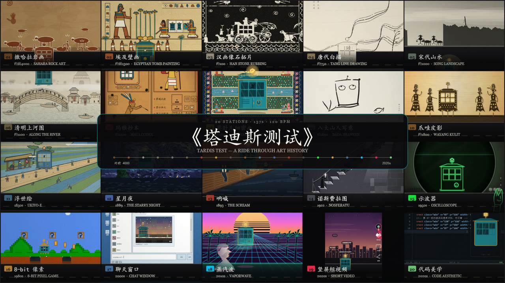

**没有一帧图像素材，没有一个音频采样，没有一处 AI 生成图。**
8220 帧画面与 137 秒配乐全部由代码算出，再交给 ffmpeg 合成。运行时 npm 依赖只有 1 个。

| 指标 | 数值 |
|---|---|
| 时长 | 137s（60 小节）@ 120 BPM |
| 帧数 | 8220 @ 60fps |
| 版块 | 20 个，各 3 小节 / 6 秒 |
| 源码 | 61 files / 22,398 行 |
| 工具脚本 | 14 files / 964 行 |
| 运行时依赖 | `puppeteer-core`（唯一） |

## 技术栈

| 层 | 实际用的东西 | 是否 npm 包 |
|---|---|---|
| 绘制 | p5.js 2.0.3（Canvas 2D 渲染器）+ p5.brush，vendored 在 `public/vendor/`，`<script>` 直接引入 | 否 |
| 抽帧 | puppeteer-core ^24.43.1，驱动本机 Chrome | 是（唯一依赖） |
| 音频 | 浏览器原生 Web Audio API，在 `OfflineAudioContext` 里离线算完整片 | 否 |
| 编码 | 系统 `ffmpeg` 可执行文件，Node `child_process.spawn` 调用 | 否 |
| 服务 | 手写静态服务器 `tools/serve.js`（ES Module 需要 http:// 才能加载） | 否 |

没有 Remotion、Three.js、WebGL、PixiJS、GSAP、React、打包器，也没有 ffmpeg 的 npm 封装。

## 一条单向的管线

画面：

```
src/scenes/sNN-*.js       每个版块一个纯渲染函数 render(g, meta, local)
  ↓  src/main/main.js     renderFrame(g, t) —— 给时间，出像素
  ↓  index.html?still=1   noLoop()，把 renderFrame 挂到 window.__seek(t)
  ↓  tools/render.js      Puppeteer 逐帧：__seek → 等 __FRAME_READY → canvas.screenshot
  ↓  frames/film60/       frame_0000.png … frame_8219.png
```

声音：

```
src/audio/engine.js       一条主旋律，喂给 20 套「乐器皮肤」
  ↓  OfflineAudioContext  无头 Chrome 里离线算完整片（约 3 分钟）
  ↓  tools/render-audio.js 分块 base64 回传 PCM，手写 44 字节 RIFF 头
  ↓  audio/film.wav       48kHz / 16bit
```

合流：

```bash
npm run audio                 # -> audio/film.wav
npm run render -- --fps 60    # -> frames/film60/*.png
npm run mux -- --frames frames/film60 --fps 60 --audio audio/film.wav --out out/film.mp4
npm run film                  # 上面三步一键跑完
```

`tools/render-parallel.js` 把整片切 12 段、起 12 个 Chrome 并行渲染（错峰 2500ms 启动，避免 12 个实例同一秒抢 CPU）。60fps 全片约 1 小时。

## 画面

每个版块在 1000×1000 单位空间内作画，映射到中央 1080×1080 正方形，左右各 420px 边区。公路、画框、标题卡由主调度统一绘制，场景只负责「地面以上」。

<table>
<tr>
<td width="33%">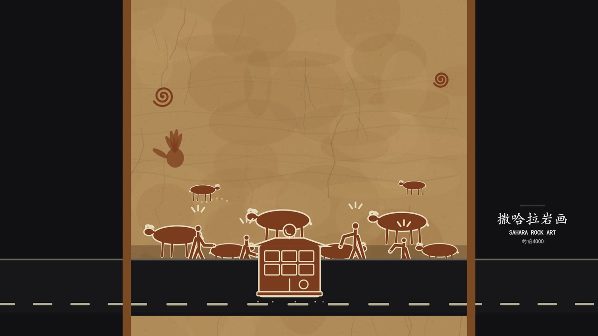<br><sub><b>撒哈拉岩画</b> 约前4000<br>赭石墙面与岩画粗线，牲畜与放牧人围成一层</sub></td>
<td width="33%">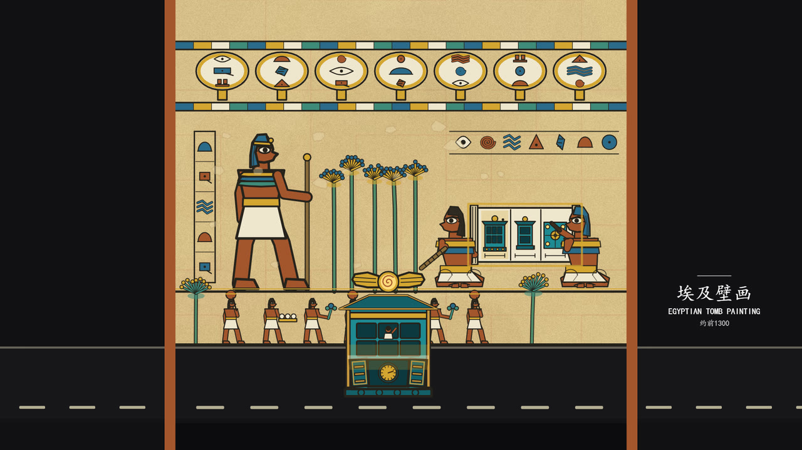<br><sub><b>埃及壁画</b> 约前1300<br>正面律构图、矿物色块与柱式分割</sub></td>
<td width="33%">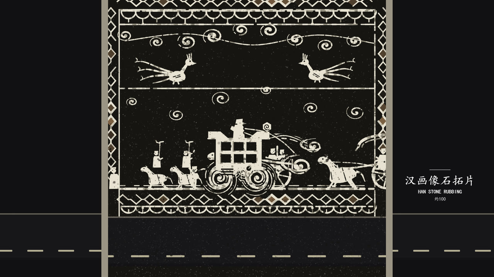<br><sub><b>汉画像石拓片</b> 约100<br>黑底白线的墨拓反相，颗粒由固定种子生成</sub></td>
</tr>
<tr>
<td width="33%">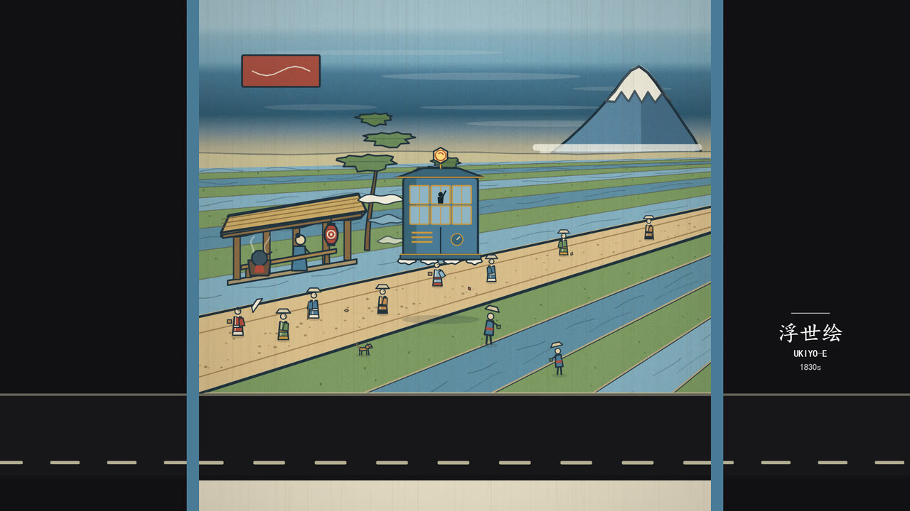<br><sub><b>浮世绘</b> 1830s<br>普鲁士蓝、雨线与条纹田，远处一座雪顶山</sub></td>
<td width="33%">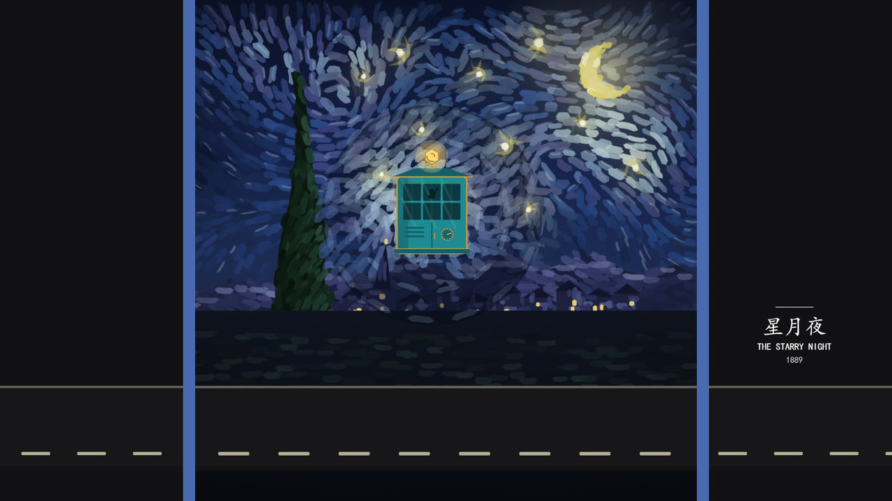<br><sub><b>星月夜</b> 1889<br>短促涡旋笔触，舱体退成一枚平涂图标浮在笔触之上</sub></td>
<td width="33%">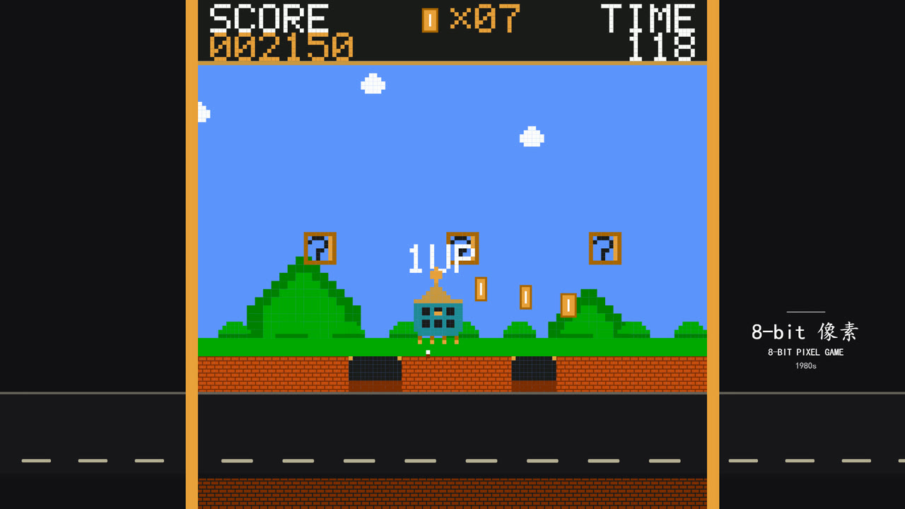<br><sub><b>8-bit 像素游戏</b> 1980s<br>硬栅格与限色板，舱体变成一枚瓦片精灵</sub></td>
</tr>
<tr>
<td width="33%">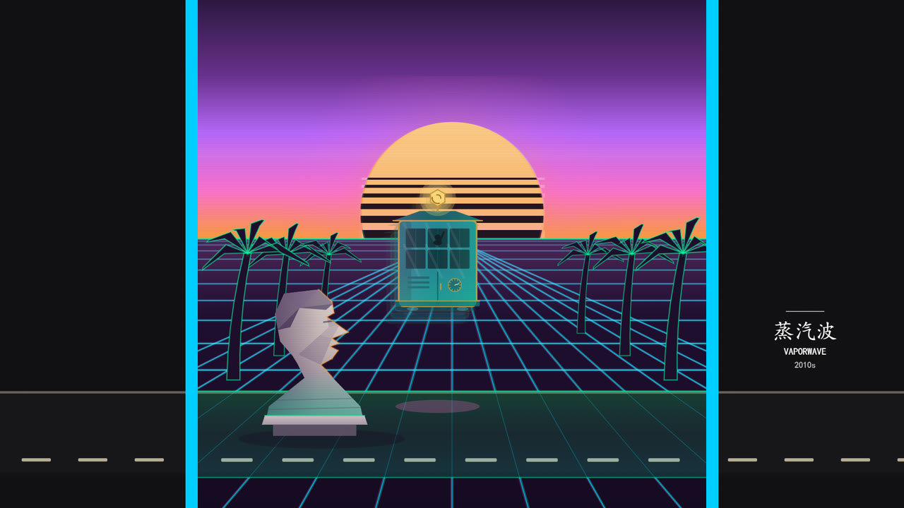<br><sub><b>蒸汽波</b> 2010s<br>渐变落日、线框地平线与棕榈，全场唯一的磁带型版块</sub></td>
<td width="33%">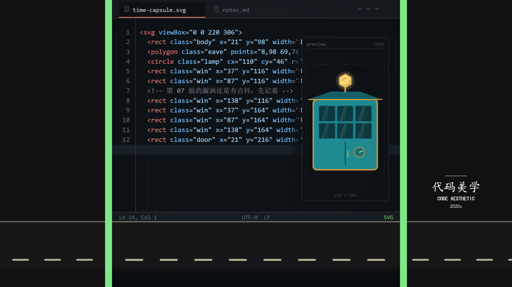<br><sub><b>代码美学</b> 2020s<br>等宽字、语法高亮与终端绿，回到「这一切是代码」</sub></td>
<td width="33%">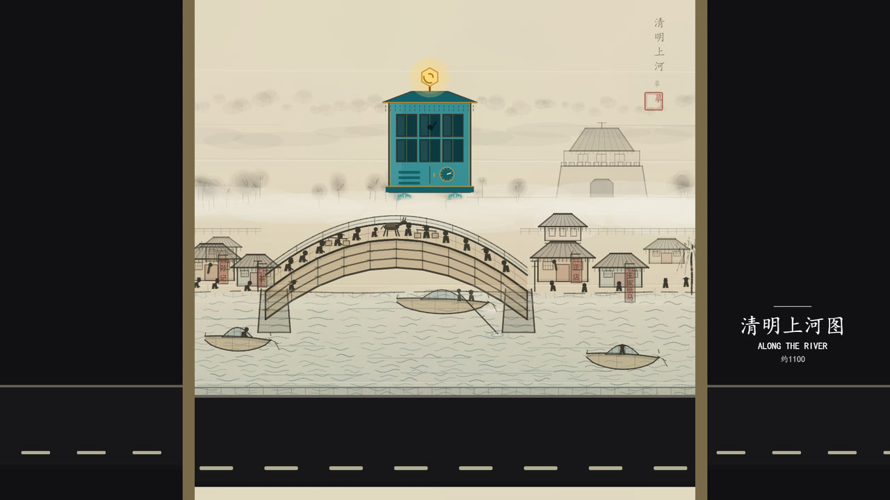<br><sub><b>清明上河图</b> 约1100<br>绢本淡彩与长卷式横向展开</sub></td>
</tr>
</table>

## 细节

同一套骨架，三种完全不同的笔法。下面三张是 1080p 画面 **1:1 裁切**，没有缩放，也没有滤镜。

<table>
<tr>
<td width="33%">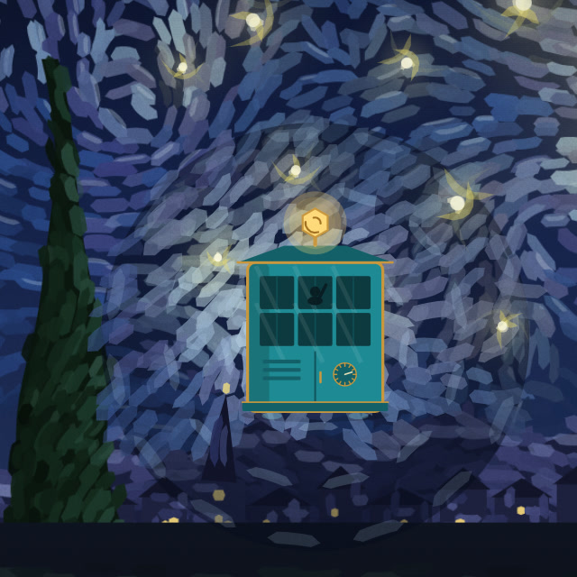<br><sub><b>笔触</b><br>油画笔触是一组带固定种子抖动的短多边形，不是贴图</sub></td>
<td width="33%">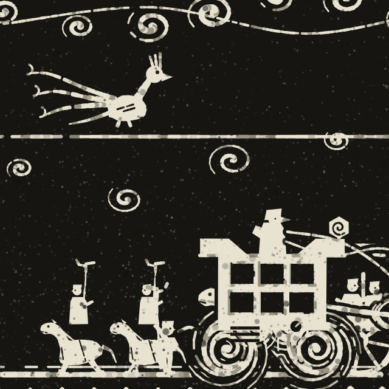<br><sub><b>颗粒</b><br>拓片颗粒由 mulberry32 生成并缓存为一张小噪声图平铺</sub></td>
<td width="33%">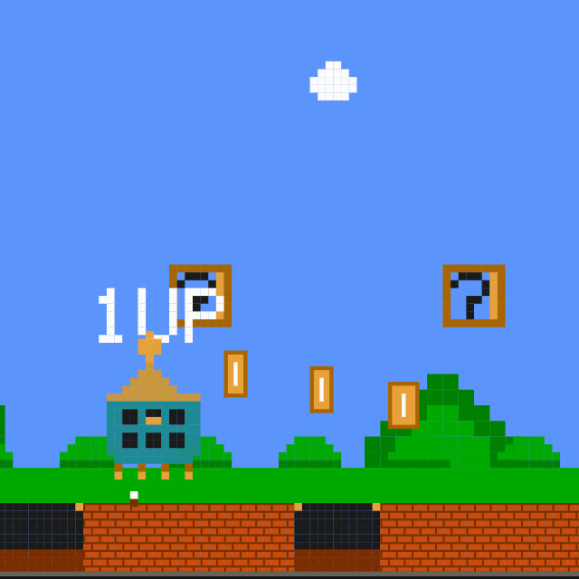<br><sub><b>像素栅格</b><br>像素版块按 5px 网格对齐绘制，边缘零抗锯齿</sub></td>
</tr>
</table>

## 为什么不用 Remotion / Three.js

Remotion 的模型是「用 React 组件描述时间轴」，需要 React、打包器，以及每帧 mount/unmount 的运行时。本项目反过来：每帧被压缩成一个**纯函数** `renderFrame(g, t)` —— 给时间，出像素，无隐藏状态。收益是三个方向的解耦：

1. 20 个版块可以派给 20 个子代理并行开发，每人只拥有一个文件
2. 抽帧可以切 12 段并行，彼此不共享任何状态
3. 任意一帧出错，`--times 5.5` 单独截一张就能复现，不用等整片

## 确定性三原则

逐帧导出时，**每一帧都是一次独立的进程调用**。任何隐藏状态都会变成画面抖动，所以这三条是硬规矩：

1. 纹理只能用 `g.createGraphics` 在模块级缓存一次，禁止每帧重建（否则导出慢到不可用）
2. 随机数必须用固定种子的 `mulberry32`，禁止 `Math.random()` 与 `Date.now()`
3. 每帧必须可重入，不在 `render` 里累加计数器、不依赖上一帧状态

## 契约驱动：prompt 是怎么组织的

不是一段大 prompt，而是**把约束写进仓库，用文件系统当 prompt**。四层：

| 层 | 文件 | 解决什么 |
|---|---|---|
| 全局规格 | `src/beat/beats.js`（92 行） | 唯一时间源。137s / 120BPM / 每格 6s / 过框落在第 6 秒。所有模块从这里取值，不许自己算 |
| 技术契约 | `briefs/API.md`、`briefs/AUDIO_API.md` | 函数签名、1000×1000 单位空间、路面带 y 770..940、已知坑清单、版权红线 |
| 单点美术规格 | `briefs/NN-slug.md` ×17 | 固定字段：画风锚点 / 构图 / 笔法 / 调色（精确 hex）/ 舱体形态 / 梗 / 强拍动作 / 禁止项 |
| 交付回路 | `tools/probe.js` + `tools/render.js` | 出 6 张接触表，自己看图判断，不满意就改 |

隔离约束同样关键：**一个子代理只许新建一个 `src/scenes/sNN-*.js`**，禁止改 `index.js` / `kit/` / `rig/` / `beat/` / `meta.js`。觉得公用工具包缺东西，只能在汇报里说明，由主代理统一添加。20 个并发写手不打架，靠的就是这条。

## 目录结构

```
src/beat/beats.js        时间轴（唯一时间源）：120BPM、版块切换、过框判定、路线进度
src/kit/                 共用绘图工具包：颗粒/晕影/标题卡/素描笔触、时间公路
src/rig/capsule.js       参数化时空舱（+ 驾驶员剪影）；姿态由 beats 驱动
src/scenes/meta.js       20 个版块元数据与配色
src/scenes/sNN-*.js      20 个正式场景 + 片头 + 片尾
src/main/main.js         主调度：镜头/边区/画框/标题卡/预览 UI

src/audio/theory.js      音阶库与变体映射（同一旋律换音阶=换时代）
src/audio/melody.js      全片唯一的主旋律（12 小节 A 小调骨架）+ 和声进行
src/audio/synth.js       Web Audio 合成原语（零采样：拨弦/FM/管乐/弓弦/鼓/混响）
src/audio/engine.js      总线 + 全片编排：把同一条旋律喂给每个版块的乐器
src/audio/sections/      20 个版块的「音乐皮肤」a01…a20 + 片头片尾

tools/serve.js           本地静态服务器（ES 模块需要 http://）
tools/render.js          Puppeteer 逐帧导出
tools/render-parallel.js 切 12 段并行抽帧
tools/render-audio.js    无头 Chrome 跑 OfflineAudioContext → WAV
tools/mux.js             帧序列 + WAV → MP4
tools/cover.js           生成 1920×1080 视频封面
tools/probe.js           抓页面报错 + 单帧耗时
briefs/                  美术简报与技术契约（阶段 3 / 4 派子代理用）
public/vendor/           p5.js 2.0.3（LGPL-2.1）、p5.brush（MIT）
```

## 快速开始

```bash
npm install                       # 只装 puppeteer-core
npm run serve                     # http://127.0.0.1:8846/ 预览（空格播放，←/→ 跳 5 秒）
npm run render -- --from 5 --to 11 --fps 30 --out frames/run
npm run sheet -- frames/run       # 生成接触表 HTML
npm run cover                     # 生成 1920×1080 封面 -> out/cover.png
npm run film                      # 一键：音轨 + 帧序列 + MP4（60fps，约 1 小时）
```

只想看一眼画面、不想装依赖：

```bash
python -m http.server 8846        # 然后打开 http://127.0.0.1:8846/
```

抽帧脚本默认就连 `127.0.0.1:8846`，所以这条命令的预览效果和 `npm run serve` 等价。

> **三个 HTML 必须走 http，不能双击打开。** 它们都是 ES Module 页面，`file://` 下浏览器会以 `origin 'null'` 触发 CORS 拒绝加载模块（`Access to script ... has been blocked by CORS policy`），页面只会白屏。

单帧调试：

```bash
node --check src/scenes/sNN-slug.js                                  # 语法
node tools/probe.js 12.5                                             # 页面报错 + 单帧耗时
node tools/render.js --scene 12 --times 0.5,2.2,3.2,4.2,5.2,5.9 \
     --out frames/starrynight                                        # 6 张静帧
```

音频也可以在浏览器里试听：开 serve 后打开 `/audio.html`，可整片渲染，也可下拉选单版块。

## 时间轴

| 区段 | 时长 | 内容 |
|---|---|---|
| 片头 | 2.5 小节 = 5s | 纸张质感、纪录片字幕、时空舱驶入 |
| 20 版块 | 各 3 小节 = 6s | 第 1 小节进场 / 第 2 小节高光 / 第 3 小节过框 |
| 片尾 | 6 小节 = 12s | 新闻发布会，7×3 展墙推向第 21 格 |

全片 137s，共 60 小节。

## 音乐

全片只有**一条**主旋律（12 小节，A 小调骨架），20 个版块各取 3 小节，5 次循环正好走完 60 小节；每个版块只决定「用什么乐器、什么音阶演奏它」。

1. 旋律以「相对主音的半音数」存储，每格按该时代音阶做就近吸附（埃及 Hijaz 出增二度、浮世绘都节音阶、甘美兰 pelog、全音阶…），于是轮廓始终是同一条，听感却一直在换
2. 全部 Web Audio 程序合成，没有任何采样：拨弦用加法合成（泛音各自衰减）、钟与锣用非整数比 FM、管乐是三角波 + 气声噪声、混响 IR 也是现算的
3. 过框音（21 次）是贯穿全片的节奏锚点：风声 + 金属拨响 + 低频推力
4. 第 18 格蒸汽波是唯一的「磁带型」版块：素材先以 151.2 BPM 生成并升 4 个半音，主时间轴以 `playbackRate 0.7937` 播放降回 120BPM 与主调；进框减速、出框加速，第 2 小节每个音重复两遍做跳针，再叠大混响、4kHz 低通、0.5Hz 摇晃与磁带底噪

## p5.js 2.x 已知坑

| 现象 | 绕法 |
|---|---|
| `beginShape()` + `bezierVertex()` 抛错 | 用独立 `g.bezier()`，或先 `vertex()` 打底 |
| `ctx.filter='blur()'` 与 p5 形状混用，图形整个不显示 | 纯 ctx 画或纯 p5 画，二选一 |
| 设了 `ctx.fillStyle = grad` 后调 `g.rect()`，渐变被覆盖 | 渐变一律 `ctx.beginPath(); ctx.rect(); ctx.fill()` |
| 逐段 `line()` 堆毛笔线出现「串珠感」 | 用变宽度多边形填充，或 `src/kit/ink.js` 的 `inkStroke` |
| p5.brush 补丁下 `p5.text` 字号状态不可靠 | 文字走原生 `ctx.fillText` |

另外：`render-audio.js` 里的 `protocolTimeout: 900000` 不能省。整片 `OfflineAudioContext` 要算 3 分钟以上，默认 180 秒协议超时会直接崩，而且报错不会告诉你是超时。

## 依赖与版权

运行时 npm 依赖只有 `puppeteer-core`；p5.js（LGPL-2.1）与 p5.brush（MIT）以 vendored 形式随仓库分发；ffmpeg 只在外部调用、不打包。详见 [NOTICE.md](NOTICE.md) 与 [THIRD_PARTY_NOTICES.md](THIRD_PARTY_NOTICES.md)。

本项目自身的代码与成片统一采用 **MIT License**，见 [LICENSE](LICENSE)。第三方组件仍遵循各自的许可，不因本项目授权而改变。

所有版块只致敬**已进入公有领域**的风格与作品，不复刻任何可辨认的具体作品构图，不出现真实品牌、logo、界面元素；聊天软件 / 短视频 / 游戏 / 编辑器一律使用虚构名称与自绘图标。

> 「塔迪斯 / TARDIS」与《神秘博士》为 BBC 受保护 IP。本片仅以其为内部灵感，成片使用原创时空舱与原创驾驶员设计，不复刻蓝色警亭外观、灯箱文字、logo 或音效。目录名仅为内部代号。
